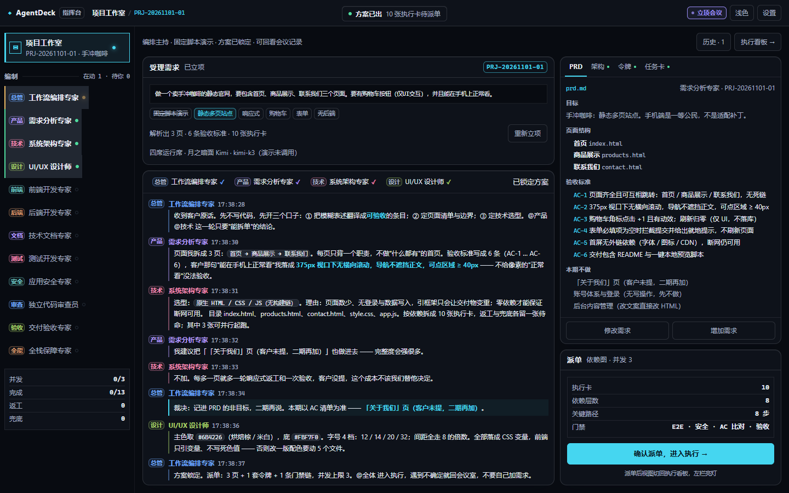
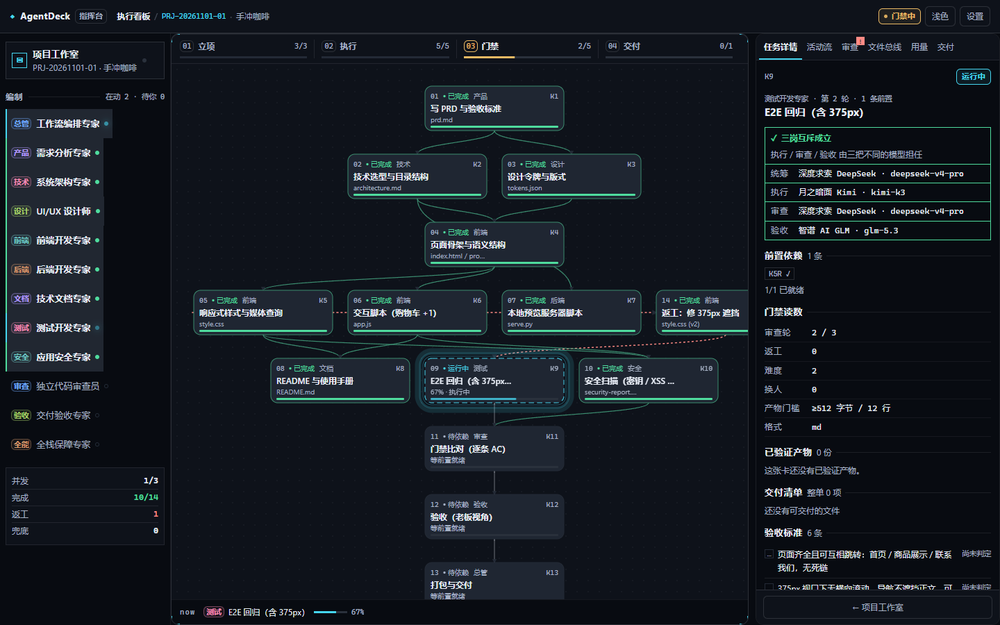
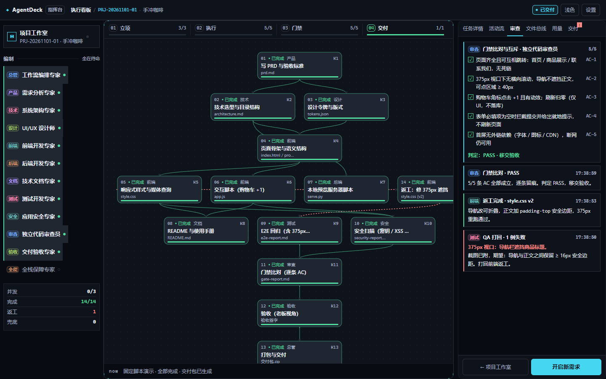
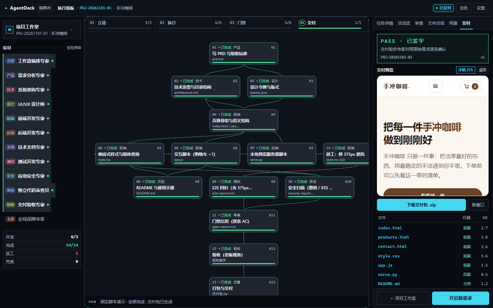
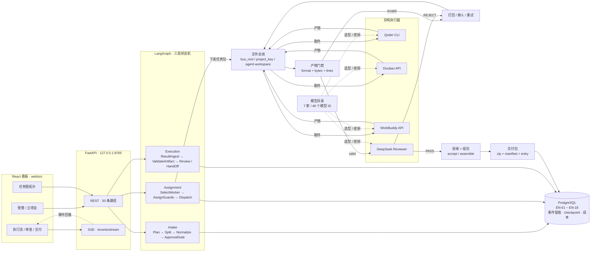

<div align="center">

<!-- README_SYNC: source=working-tree; updated=2026-11-01 -->

<p align="center">
  简体中文 · <a href="./README_EN.md">English</a>
</p>

# AgentDeck

**把"谁做、谁审、谁签、凭什么签"写成状态机、数据库约束和文件总线上的可复算读数。**

面向在本机跑多 Agent 研发的独立开发者与小团队：一句话需求进来，四个岗位立项、拆卡、派单、执行，产物过门禁，签字留痕。
它是**本机单用户**工具 —— 只绑环回地址，没有登录，不是多租户 SaaS。

> 如果它解决了你的问题，点一个 Star：方便以后回来，也让更多有同样需求的人更容易发现它。问题和改进建议请直接提 Issue。

[](https://github.com/qingfeng092802/AgentDeck/stargazers)
[](pyproject.toml)
[](LICENSE)
[](https://www.python.org/downloads/)
[](https://nodejs.org/)
[](https://www.postgresql.org/)
[](tests)
[](web)

[差异](#与手写脚本的差别) · [快速开始](#快速开始) · [架构](#架构) · [判据面](#判据面) · [已知限制](#已知限制--honest-boundaries) · [License](#license)

</div>

---

## 一句话能走到哪

```text
一句话需求 → 四岗位立项会 → PRD / 架构 / 令牌 → 拆卡 → A 类审批 → 派单 → 执行
          → 产物门禁 → 审查 → 验收 → 交付包（zip + manifest + entry）
```

每一跳都往 PostgreSQL 写一行事实，每一次拒绝都有原因词，每一个结论都能被重新读出来。
这条线不靠提示词自律：**没过互斥的任务卡派发不出去，没过门禁的产物进不了交付包。**

## 与"手写脚本"的差别

同类框架默认都有的东西（图编排、工具调用、流式输出）不在这里列出。下面每一行都有唯一强制点：

| 你在解决的问题 | 常见做法 | 本项目的做法 |
| --- | --- | --- |
| Agent 自己审自己 | 靠提示词要求"换个角色评审" | 执行 / 审查 / 验收三席身份两两不同，唯一强制点 [`src/acp/guard/triple.py`](src/acp/guard/triple.py)；**未指派（NULL）不算"天然不同"**，重复即拒 |
| 产物"看起来完成了" | 采信 Agent 的 `self_reported_status` | 门禁只认总线实测：格式 + 字节数 + 行数；结构性截断或 `finish_reason=length` ⇒ **不写盘、零产物**（[`src/acp/content_gate.py`](src/acp/content_gate.py)） |
| 状态存在内存里，跑完就没了 | 日志文件 / 会话历史 | PostgreSQL 是唯一事实态：EN-01 ~ EN-18、事件留痕、LangGraph 的 PG checkpoint、成本账 |
| 想换个模型只能改代码 | 一处 `model=` 常量 | 受理请求带 `model_routing`：三个席都能点名成模型实例，**key 只进进程内存**，落库的是短指纹（[`src/acp/routing.py`](src/acp/routing.py)） |
| 谁签字说不清 | 一个 admin 全权 | `ACP_APPROVAL_MODE` 只管拆单确认、`ACP_REVIEW_MODE` 只管逐卡评审，两格互不推导；机器代签要同时过四道闸 |
| 出问题时无法复现 | "我记得那次是好的" | 判据分档跑、可复算；本机 2026-11-01 全量读数见[判据面](#判据面) |

## 界面

|  |  |
| :---: | :---: |
|  |  |
| **项目工作室 · 立项**<br><sub>一句话受理 / 四岗位会议 / PRD 与验收标准</sub> | **执行看板 · 任务图**<br><sub>依赖 DAG / 四阶段读数 / 三岗互斥判据</sub> |
|  |  |
| **审查页签 · 门禁**<br><sub>逐条 AC 比对 / 判定 PASS / 返工留痕</sub> | **交付页签 · 签字**<br><sub>验收 PASS / 页面预览 / 文件清单 / zip</sub> |

> 上面四张是本机实拍（1440×900），跑的是前端**固定演示脚本**：不调用任何模型、不连后端，项目键 `PRJ-20261101-01` 与需求文案「手冲咖啡」都是示例数据。真实链路请本地起一发：`cd web && npm install && npm run dev`，看板在 `127.0.0.1:5178`。前端源码入口 [`web/src/views/StudioView.tsx`](web/src/views/StudioView.tsx)。

## 快速开始

### A 路：一条命令（Docker）

```bash
cp .env.example .env
docker compose up -d --build
```

打开 `http://127.0.0.1:8765/`。

镜像两段构建：`node` 阶段先出看板产物（`tsc --noEmit && vite build`），`python:3.12-slim` 再装依赖并把 `dist` 烘进去；容器自己等数据库、跑 `alembic upgrade head`、然后起 `python -m acp.serve`。宿主机不需要装 Python、Node 或 PostgreSQL。

几个刻意的边界：

- **发布端口只在环回**（`127.0.0.1:8765`）。容器内必须绑 `0.0.0.0` 才收得到包，所以 `docker-compose.yml` 给它设了 `ACP_ALLOW_NON_LOOPBACK=1`；但本仓无鉴权，能连到它的仍然只有这台机器。撞端口改 `.env` 的 `ACP_APP_PORT`。
- **凭据不进镜像**：`.env` 在 `.dockerignore` 里，compose 用 `env_file` 在运行期注入。
- **没有厂商 key 也能起来**：看板、受理、审批、交付、迁移都可用；只有真跑模型的那几步停在凭据缺失上，不会整屏报错。
- **审批身份**：`ACP_APPROVAL_MODE` 缺省 `auto`（拆单免确认）。要逐单人工批，写 `manual` 并配 `ACP_APPROVERS`（逗号分隔），由 [`docker/entrypoint.sh`](docker/entrypoint.sh) 展开成 `--approver`；一个都不给时审批端点回 **503** `approvers_not_configured`，看板能看不能批 —— 这是刻意的。
- 容器名与镜像名沿用历史命名（`acp-db` / `acp-app:local`），不影响功能，保留是为了避免升级时数据卷迁移。

验收脚本（在有 Docker 的机器上跑，本 README 不替它宣布结果）：

```bash
bash scripts/verify-docker.sh
```

### B 路：本地开发（改后端 / 前端时用这条，热更新比重建镜像快）

```bash
python -m venv .venv
source .venv/bin/activate
pip install -e ".[dev]"
cp .env.example .env
```

Windows 上激活脚本是 `.venv\Scripts\activate`。Python 版本被 `pyproject.toml` 钉在 `>=3.12,<3.13`。

```bash
docker compose up -d db

set -a; source .env; set +a
alembic upgrade head
python -m acp.selfcheck
```

`acp.serve` 只读进程环境、不自动读 `.env`，所以那两行 `set -a` 不是可省的装饰。当前迁移头是 `model_routing`（`alembic heads` 可读回），版本文件 13 个。

```bash
cd web
npm install
npm run dev
```

看板在 `http://127.0.0.1:5178/`，`vite.config.ts` 把 API 前缀代理到 `127.0.0.1:8765` —— 改前后端时这套最快。

```bash
cd web
npm run build
cd ..
python -m acp.serve --port 8765 --approver owner
```

生产形态由后端同源挂载同一个 8765。这里有一道刻意的闸：`acp.serve` 在挂看板之前会检查 `web/dist`，目录不在就直接以 `BoardAssetsMissing` 拒绝启动（[`src/acp/app.py`](src/acp/app.py)），而不是给你一个"站点在跑、点开全 404"的空壳 —— 所以这一步必须先 build 过。

### 发起第一条需求

入口是**项目工作室**：默认本地推演，不请求后端，按同一套状态机演示立项 → 会议 → 派单 → 执行 → 交付；填了项目键才走真链路。

真厂商执行入口：

```bash
python -m acp.realrun --project <project_key> --request "<one-sentence requirement>" --bus-root results
```

`--bus-root` 请给绝对路径或相对于运行目录的目录名；产物归属按总线根换算，总线根之外的位置会被 FR-013 整批拒收。

## 架构



四条硬约束，不是设计愿景：

- **事实态唯一**：PostgreSQL 是唯一权威；LangGraph state 只活在一次运行里，不持久化成第二份事实。
- **派发前互斥**：图上入边只有 `AssignGuards → Dispatch`，没过三岗互斥的任务卡派发不出去。
- **先门禁后审查**：`ValidateArtifact` 写结论、路由只读结论，门禁不认自评。
- **交付只收 valid**：入口文件必须真实存在、每个需求单唯一一份、冲突裁决人不得是冲突方。

选人也不是随机：`SelectWorker` 按能力匹配、层级匹配、历史成功率、当前负载与 `agent_id` 做五段全序，`current_load >= max_parallel` 直接出局（[`src/acp/orchestrate/nodes/select_worker.py`](src/acp/orchestrate/nodes/select_worker.py)）。四岗位读的角色提示词直接落在仓库里，可以逐字看（[`src/acp/prompts/roles/pm.md`](src/acp/prompts/roles/pm.md)）。

## 对外读面

`create_app()` 的 OpenAPI 现在有 **30 条路径 / 33 个操作**（复算命令在[判据面](#判据面)）。分族：

| 族 | 用途 |
| --- | --- |
| `/requests` | 受理、回读、续跑、重试、延期、证据、交付包 |
| `/tasks` | 任务卡读写、评审、评审报告、换人、产物重试、升级 |
| `/approvals` | A/B/C 类审批单列表、详情、逐单与批量裁决，以及单据事件流 |
| `/runtime` `/autonomy` | 运行参数与分级授权开关（读不需要身份，写需要） |
| `/events` `/events/stream` | 活动流读数与 SSE 一条长连接 |
| `/growth` | 档案位读写 |

SSE 只负责"有事发生"，数据仍然走数据库读面。请求 / 响应字段的权威表在 [`specs/001-multi-agent-collab-platform/contracts/approval-api.md`](specs/001-multi-agent-collab-platform/contracts/approval-api.md)；协议层的约束写在 [`specs/001-multi-agent-collab-platform/contracts/agent-protocol.md`](specs/001-multi-agent-collab-platform/contracts/agent-protocol.md)。

## 配置

`.env` 只列名字，取值一律不入库；变量名与用途见 [`.env.example`](.env.example)，参数、凭据与超时的权威出处是 [`config/params-ref.md`](config/params-ref.md)。常用的几格：

| 变量 | 用途 |
| --- | --- |
| `ACP_DB_DSN` | PostgreSQL 连接串；缺省时需要 PG 的用例整档 **skip**（skip 不等于通过） |
| `ACP_PG_PASSWORD` / `ACP_PG_HOST_PORT` | 只给 `docker compose` 起库用；宿主 5432 被原生实例占用时换端口，DSN 与它必须一致 |
| `ACP_REVIEW_MODE` | `manual`（默认）/ `deepseek` / `auto`，只管逐卡评审 |
| `ACP_APPROVAL_MODE` | `auto`（未设置时的缺省）/ `manual`，只管拆单确认，与评审模式互不推导 |
| `ACP_AUTO_ACCEPT_LOW_RISK` | 低风险机器代签开关；开启需同时满足开关、风险档、三岗互斥、独立审查 PASS |
| `ACP_MEETING_ROUNDS` | 立项会轮数，`1`–`3`，默认 `2` |
| `ACP_BUS_ROOT` | 文件总线根；产物归属按它换算 |
| `DEEPSEEK_API_KEY` / `ARK_API_KEY` / `WORKBUDDY_SECRET_ID` / `WORKBUDDY_SECRET_KEY` / `QODER_PERSONAL_ACCESS_TOKEN` | 各家执行器与评审的凭据；缺失只影响真跑模型那几步 |
| `ACP_ALLOW_NON_LOOPBACK` | **只该由容器设成 1**。本机手工跑时设它，等于把无鉴权的写端点交给局域网 |

模型目录（[`web/src/lib/modelCatalog.ts`](web/src/lib/modelCatalog.ts)）覆盖 **7 家 / 46 个模型 ID**：DeepSeek、通义千问、豆包、Kimi、智谱 GLM、MiniMax、OpenAI 兼容（自定义接入地址）。其中前三家的名单逐条来自账号 `GET /models` 实测，后四家**本轮无 key、未核** —— 未核不等于错，但也不要当成已验证。漂移检查：

```bash
python scripts/check_model_catalog.py
```

## 安全与运行边界

- 服务只绑 `127.0.0.1` / `::1`，`--host 0.0.0.0` 在启动前被拒（`HostRefused`）。每个 HTTP 请求还过一道 `Host` 校验，挡 DNS rebinding。
- **没有登录。** 身份头只挡误操作，不挡冒充。这是本机单用户工具：不要把它放到公网，也不要放到你不信任的局域网。
- 凭据只从 `.env` 进进程环境；代码、文档、日志与提交里不出现取值。请求级路由带来的 key 只留在进程内存，落库的是短指纹，重启即失效。
- 三岗互斥、只读隔离、危险动作拦截是协议层约束，不是 UI 提示。
- 真厂商调用会产生费用；推演模式与 Stub 不产生外部调用。

## 判据面

本仓的主力不是 CI 徽章，是**能复算的用例**。2026-11-01 在本机（Windows + `.venv` 3.12.13 + Docker Desktop 里的 PostgreSQL 16 容器，目标库为同实例新建的 scratch 库）实测：

| 档 | 读数 |
| --- | --- |
| 全量 `python -m pytest` | **2774 passed / 2 skipped / 1 warning**，211.90 s |
| 分档 collect（guards / contract / integration / e2e） | 1363 / 910 / 500 / 3 = 2776 条 |
| 前端 `npm test`（vitest） | **210 passed / 15 files** |
| 静态门禁 `python -m mypy` | 范围**刻意只开两个承重目录**：`orchestrate/` 与 `adapters/`（见 `pyproject.toml`） |
| `python -m acp.selfcheck` | C1 PASS 3.12.13、C2 PASS PostgreSQL 16.15、C4 PASS entries=4、C5 PASS declared=11；C3 BLOCKED（总线未初始化，`workspaces=0`）⇒ `CHECKPOINT0 PASS`，门 = C1∧C2∧C5 |

跑全量前请把运行时开关摘干净 —— 它们会改变默认态断言：

```bash
unset ACP_REVIEW_MODE ACP_APPROVAL_MODE ACP_AUTO_ACCEPT_LOW_RISK

python -m pytest
python -m pytest tests/guards tests/contract
python -m mypy

cd web
npm test
npm run build
```

读数的复算命令（三条都是本仓在跑的那三条，不是示意图）：

```bash
# public HTTP surface: paths and operations
PYTHONPATH=src python -c "from acp.app import create_app; s = create_app().openapi(); print(len(s['paths']), sum(len(v) for v in s['paths'].values()))"

# cases per tier (change the directory, change the tier)
PYTHONPATH=src python -m pytest -o addopts= -q --collect-only tests/guards | grep -c '::'

# registry and dependency self-check
python -m acp.selfcheck
```

仓库里**没有** `.github/workflows`：判据靠本地跑，不靠 CI 徽章。这一点写在这里，是为了不让人误以为有一条没人看的流水线在守门。

## 已知限制 · Honest Boundaries

### 1. 拆单不会点名 `.js` 产物

`orchestrate/llm_split.py::skeleton_from_prd` 只按 PRD 的 `pages[]` 投影：页面卡会点名 `.html`，另有 `.css` / `.py` / `.md` 卡；协议层已支持 `js`，但拆单**不要求 `xxx.js`**。所以"给表单加前端校验"这类需求可能整单跑到 `DELIVERED`，产物里却没有 `.js`。修法只有一处：给页面卡补一条文件名判据，其余层（格式枚举、产物下限、扫描白名单）已就位。

### 2. 任务图不缩放，特定视口会留白或横向滚动

图是固定坐标的 SVG，节点字号只有 10–12 个用户单位，一缩字就糊。宽度按最宽一列现算（当前 13 节点分 3 列 = 672px），三栏下界由 `rail + side + DAG + padding + 滚动条 + 缝` 算出 1321，断点取 **1336**；1335 及以下右栏沉底，**1000 以下整壳横向滚动并明示**，不做伪响应式。五个数与算式只有一个载体：[`web/src/styles/tokens.json`](web/src/styles/tokens.json)。

### 3. 模型目录不等于已接通执行器

后端真跑链路的内置注册表是 4 条（Qoder / 豆包 / WorkBuddy / DeepSeek Reviewer，形态 `API` / `IN_PLATFORM` / `SDK`，见 [`src/acp/registry/agents.yaml`](src/acp/registry/agents.yaml)）。目录里的 46 个 ID 靠请求级 `model_routing` 或设置页的自定义模型池接上；平台自带的门禁检查卡不调外部模型。设置页的"按设置四席运行"只验证模型与四席链路，**不写 EN-01 / EN-02，也不推进看板状态**。

### 4. 无鉴权、无多租户

一个进程一个用户。想要"团队共用一套"，需要先自己加认证层、租户隔离和审计出口 —— 本仓现在不提供，也不假装提供。

## 项目结构

```text
src/acp/            后端：api / orchestrate / guard / registry / persistence / config …
  ├─ app.py         create_app()：对外 HTTP 面的装配点
  ├─ registry/      执行器注册表与角色（agents.yaml + roles/）
  ├─ guard/         三岗互斥、只读隔离、危险动作
  ├─ orchestrate/   三段状态机的节点
  └─ persistence/   实体与迁移（13 个版本，head = model_routing）
tests/
  ├─ guards/        协议与形状守卫（无 PG 也跑）
  ├─ contract/      契约表与文档对读
  ├─ integration/   HTTP 面端到端
  └─ e2e/           全链路
web/src/            看板：views / components / shell / lib / styles
config/             运行期权威源：params-ref.md + 五份 yaml（代码直接读，不是示例）
docs/               界面实拍四张（本机推演档，不调模型、不连后端）
scripts/            verify-docker.sh / check_model_catalog.py / check_tables.py …
```

## 命名与兼容边界

品牌是 AgentDeck，但下面这些**沿用历史命名**，改动它们等于改协议、改数据库和改所有人的部署脚本，所以保留：Python 包名 `acp`（`import acp`、`python -m acp.serve`）、环境变量前缀 `ACP_`、HTTP 身份头 `x-acp-principal`、容器与镜像名 `acp-db` / `acp-app:local`。发行名已经换成 `agentdeck`（`pip install -e .` 之后 dist-info 才是新名字；从旧版本升级时装一次即可）。

## 参与

改动请先跑快档：`python -m pytest tests/guards tests/contract` + `cd web && npm test && npm run build`。协议层（三岗互斥、门禁、总线归属）的改动需要在 `tests/contract` 里有对应的判据，不接受只改实现不改判据。Issue 里请带上复现命令与读数。

如果这个项目解决了你的实际问题，可以点一个 **Star**；要跟版本用 **Watch Releases**；缺陷和改进直接开 **Issue**。

## License

MIT，全文见 [`LICENSE`](LICENSE)。Copyright (c) 2026 AgentDeck contributors。
