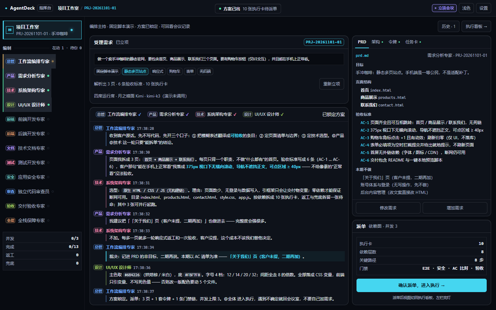
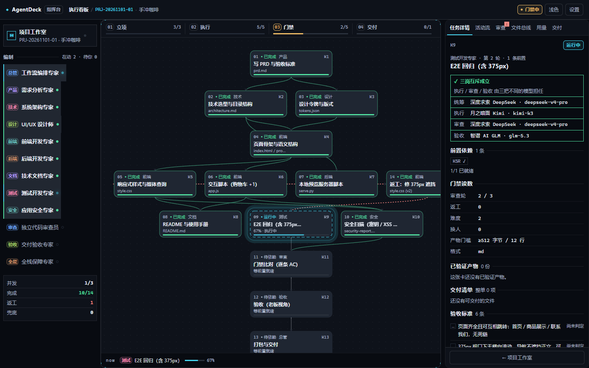
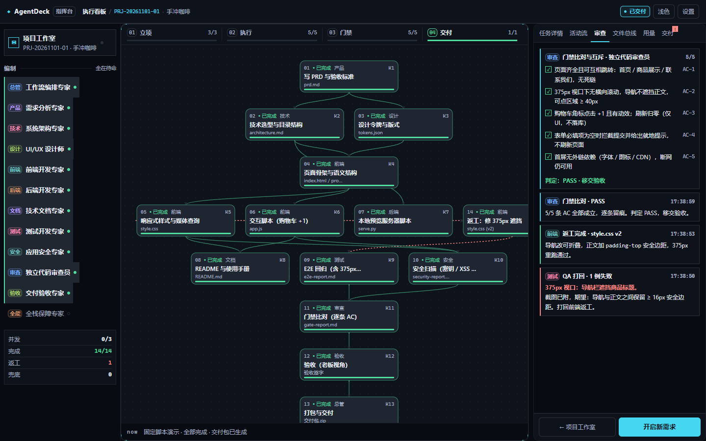
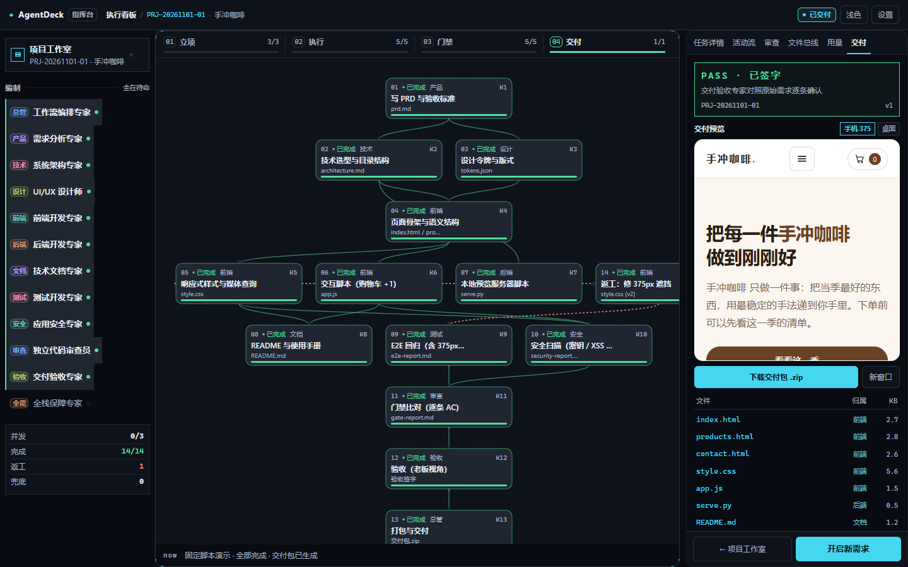
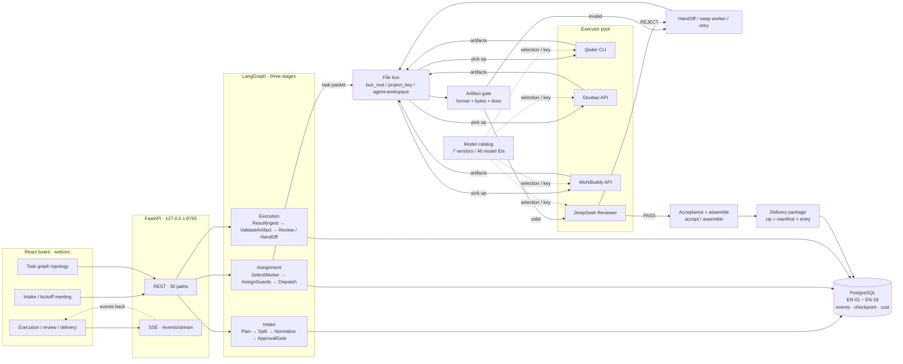

<div align="center">

<!-- README_SYNC: source=working-tree; updated=2026-11-01 -->

<p align="center">
  <a href="./README.md">简体中文</a> · English
</p>

# AgentDeck

**It turns "who did it, who reviewed it, who signed it, and on what grounds" into a state machine, database constraints and readings you can recompute off a file bus.**

Built for solo developers and small teams who run multi-agent engineering on their own machine: one sentence of a requirement goes in, four roles hold a kickoff, split the work, dispatch, execute; artifacts must pass a gate, and every signature leaves a record.
It is a **single-user, local** tool — loopback only, no login, not a multi-tenant SaaS.

> If it solves a real problem for you, a Star helps you find it again and helps other people with the same problem find it. Bugs and ideas belong in Issues.

[](https://github.com/qingfeng092802/AgentDeck/stargazers)
[](pyproject.toml)
[](LICENSE)
[](https://www.python.org/downloads/)
[](https://nodejs.org/)
[](https://www.postgresql.org/)
[](tests)
[](web)

[What's different](#what-actually-differs) · [Quick start](#quick-start) · [Architecture](#architecture) · [Checks](#the-check-layer) · [Limits](#known-limits--honest-boundaries) · [License](#license)

</div>

---

## Where one sentence goes

```text
one sentence → four-seat kickoff → PRD / architecture / tokens → task cards → class-A approval
          → dispatch → execution → artifact gate → review → acceptance → package (zip + manifest + entry)
```

Every hop writes a fact into PostgreSQL, every rejection carries a reason word, every verdict can be read back.
This line does not depend on prompts behaving themselves: **a task card that fails mutual-exclusion never gets dispatched, an artifact that fails the gate never enters the delivery package.**

## What actually differs

Baseline capabilities of this genre — graph orchestration, tool calling, streaming — are not listed. Each row below has exactly one enforcement point:

| The problem | Usual approach | Here |
| --- | --- | --- |
| An agent reviewing its own work | A prompt asking it to "switch roles" | executor / reviewer / acceptor must be three distinct identities; the single enforcement point is [`src/acp/guard/triple.py`](src/acp/guard/triple.py). **Unassigned (NULL) does not count as "distinct by default"** — a duplicate is refused |
| "It looks done" | Trusting `self_reported_status` | The gate only trusts the bus: format + bytes + lines. Structural truncation **or** `finish_reason=length` ⇒ **nothing is written to disk, zero artifacts** ([`src/acp/content_gate.py`](src/acp/content_gate.py)) |
| State lives in memory and evaporates | Log files / chat history | PostgreSQL is the only fact state: EN-01 ~ EN-18, event trail, PG checkpoint, cost ledger |
| Swapping a model means editing code | One `model=` constant | The request itself carries `model_routing`: any of the three seats can be named as a model instance, and the **key stays in process memory** — only a short fingerprint is stored ([`src/acp/routing.py`](src/acp/routing.py)) |
| Unclear who signed | One admin with all rights | `ACP_APPROVAL_MODE` governs split confirmation, `ACP_REVIEW_MODE` governs per-card review; neither implies the other. A machine signature needs four gates at once |
| No way to reproduce an incident | "I remember it was fine" | Tiered, recomputable checks; local reading from 2026-11-01 in [the check layer](#the-check-layer) |

## The board

|  |  |
| :---: | :---: |
|  |  |
| **Studio · intake**<br><sub>one-sentence intake / four-seat kickoff / PRD and AC list</sub> | **Board · task graph**<br><sub>dependency DAG / four-stage readings / independence guard</sub> |
|  |  |
| **Review tab · gate**<br><sub>AC-by-AC comparison / PASS verdict / rework trail</sub> | **Delivery tab · sign-off**<br><sub>acceptance PASS / page preview / manifest / zip</sub> |

> Those four are real captures from this machine (1440×900), driven by the front-end's **fixed demo script**: no model is called, no backend is contacted, and both the project key `PRJ-20261101-01` and the "手冲咖啡" brief are sample data. For the real pipeline, run it locally: `cd web && npm install && npm run dev`, the board listens on `127.0.0.1:5178`. Entry point: [`web/src/views/StudioView.tsx`](web/src/views/StudioView.tsx).

## Quick start

### Path A: one command (Docker)

```bash
cp .env.example .env
docker compose up -d --build
```

Then open `http://127.0.0.1:8765/`.

The image builds in two stages: the `node` stage produces the board (`tsc --noEmit && vite build`), `python:3.12-slim` installs dependencies and bakes `dist` in. The container waits for the database, runs `alembic upgrade head`, then starts `python -m acp.serve`. Your host needs no Python, Node or PostgreSQL.

Deliberate boundaries:

- **The published port is loopback only** (`127.0.0.1:8765`). Inside the container it must bind `0.0.0.0` to receive anything, so `docker-compose.yml` sets `ACP_ALLOW_NON_LOOPBACK=1` for it — but this repository has no authentication, so the set of people who can reach it is still just this machine. Change `ACP_APP_PORT` in `.env` if the port collides.
- **Credentials never enter the image**: `.env` is listed in `.dockerignore`, and compose injects it at run time via `env_file`.
- **It boots without any vendor key**: board, intake, approvals, delivery and migrations all work. Only the steps that actually call a model stop on a missing-credential reason instead of throwing a page full of errors.
- **Approval identity**: `ACP_APPROVAL_MODE` defaults to `auto` (split confirmation is waived by rule). For per-ticket human approval, set `manual` and list `ACP_APPROVERS` (comma-separated); [`docker/entrypoint.sh`](docker/entrypoint.sh) expands it into `--approver`. With no approver at all, approval writes return **503** `approvers_not_configured` and the board can read but not approve — on purpose.
- Container and image names keep the historical naming (`acp-db` / `acp-app:local`). This does not affect behaviour; they are kept so that upgrading does not require migrating data volumes.

Verification script (run it on a machine with Docker; this README does not announce its result):

```bash
bash scripts/verify-docker.sh
```

### Path B: local development (use this when editing backend or frontend — hot reload beats rebuilding an image)

```bash
python -m venv .venv
source .venv/bin/activate
pip install -e ".[dev]"
cp .env.example .env
```

On Windows the activate script is `.venv\Scripts\activate`. The interpreter is pinned by `pyproject.toml` to `>=3.12,<3.13`.

```bash
docker compose up -d db

set -a; source .env; set +a
alembic upgrade head
python -m acp.selfcheck
```

`acp.serve` reads the process environment only and never loads `.env` itself, so those `set -a` lines are not decoration. The current migration head is `model_routing` (readable from `alembic heads`), with 13 version files.

```bash
cd web
npm install
npm run dev
```

The board listens on `http://127.0.0.1:5178/`, and `vite.config.ts` proxies the API prefixes to `127.0.0.1:8765` — fastest loop when you are editing either side.

```bash
cd web
npm run build
cd ..
python -m acp.serve --port 8765 --approver owner
```

The production shape mounts the same app on 8765 from one origin. There is a deliberate gate here: before mounting the board, `acp.serve` checks `web/dist` and refuses to start with `BoardAssetsMissing` if the directory is absent ([`src/acp/app.py`](src/acp/app.py)) — rather than handing you a running site whose every asset 404s. So build first.

### Filing your first requirement

The entry point is the **studio**: by default it runs a local simulation, does not touch the backend, and walks intake → meeting → dispatch → execution → delivery through the same state machine. The real path starts once you fill in a project key.

Real vendor execution entry point:

```bash
python -m acp.realrun --project <project_key> --request "<one-sentence requirement>" --bus-root results
```

Prefer an absolute path (or a directory name relative to where you run it) for `--bus-root`; artifact ownership is resolved against that bus root, and anything outside it is rejected wholesale by FR-013.

## Architecture



Four hard constraints, not design aspirations:

- **One fact state**: PostgreSQL is authoritative; LangGraph state lives inside one run and is never persisted as a second source of truth.
- **Exclusion before dispatch**: the only in-edge is `AssignGuards → Dispatch`; a card that fails three-seat exclusion cannot be dispatched.
- **Gate before review**: `ValidateArtifact` writes the verdict and routing only reads it. The gate does not accept self-reporting.
- **Delivery accepts `valid` only**: the entry file must really exist, each request contributes exactly one package, and the arbiter of a conflict may not be one of the conflicting parties.

Worker selection is not random either: `SelectWorker` produces a five-key total order over capability match, tier match, historical success rate, current load and `agent_id`, and `current_load >= max_parallel` is simply out ([`src/acp/orchestrate/nodes/select_worker.py`](src/acp/orchestrate/nodes/select_worker.py)). The role prompts the four seats actually read are in the repository, word for word ([`src/acp/prompts/roles/pm.md`](src/acp/prompts/roles/pm.md)).

## The public read surface

`create_app()` currently exposes **30 paths / 33 operations** (recompute command in [the check layer](#the-check-layer)). By family:

| Family | Purpose |
| --- | --- |
| `/requests` | intake, read back, continue, retry, extend, evidence, delivery package |
| `/tasks` | task card read/write, review, review report, swap worker, artifact retry, escalation |
| `/approvals` | class A/B/C tickets: list, detail, single and batch resolve, plus the per-ticket event stream |
| `/runtime` `/autonomy` | runtime parameters and the staged-authorisation switches (reads need no identity, writes do) |
| `/events` `/events/stream` | activity readings and one long SSE connection |
| `/growth` | profile slots |

SSE only says "something happened"; the data still comes from the database read side. The authoritative field tables are in [`specs/001-multi-agent-collab-platform/contracts/approval-api.md`](specs/001-multi-agent-collab-platform/contracts/approval-api.md); the protocol-level constraints are in [`specs/001-multi-agent-collab-platform/contracts/agent-protocol.md`](specs/001-multi-agent-collab-platform/contracts/agent-protocol.md).

## Configuration

`.env` lists names only, values never get committed — see [`.env.example`](.env.example) for the full set, and [`config/params-ref.md`](config/params-ref.md) for the authoritative source of parameters, credentials and timeouts. The ones you will actually touch:

| Variable | Purpose |
| --- | --- |
| `ACP_DB_DSN` | PostgreSQL connection string; without it the PG-bound cases **skip** the whole tier (a skip is not a pass) |
| `ACP_PG_PASSWORD` / `ACP_PG_HOST_PORT` | used only by `docker compose` when it starts the database; if a native instance holds host port 5432, pick another one and keep the DSN consistent with it |
| `ACP_REVIEW_MODE` | `manual` (default) / `deepseek` / `auto` — per-card review only |
| `ACP_APPROVAL_MODE` | `auto` (the default when unset) / `manual` — split confirmation only, never implied by the review mode |
| `ACP_AUTO_ACCEPT_LOW_RISK` | low-risk machine signature switch; enabling it still requires risk tier, three-seat exclusion and an independent review PASS |
| `ACP_MEETING_ROUNDS` | kickoff rounds, `1`–`3`, default `2` |
| `ACP_BUS_ROOT` | file bus root; artifact ownership is resolved against it |
| `DEEPSEEK_API_KEY` / `ARK_API_KEY` / `WORKBUDDY_SECRET_ID` / `WORKBUDDY_SECRET_KEY` / `QODER_PERSONAL_ACCESS_TOKEN` | vendor credentials for executors and reviewers; missing ones only cost you the real model calls |
| `ACP_ALLOW_NON_LOOPBACK` | **should only be set to 1 by the container.** Setting it when running by hand publishes an unauthenticated write surface to your network |

The model catalog ([`web/src/lib/modelCatalog.ts`](web/src/lib/modelCatalog.ts)) covers **7 vendors / 46 model IDs**: DeepSeek, Qwen, Doubao, Kimi, GLM, MiniMax and OpenAI-compatible (custom endpoint). The first three were taken name by name from `GET /models` against real accounts; the other four are **unverified in that pass** — unverified does not mean wrong, but do not treat them as checked. Drift check:

```bash
python scripts/check_model_catalog.py
```

## Safety and runtime boundaries

- The server binds `127.0.0.1` / `::1` only; `--host 0.0.0.0` is refused before startup (`HostRefused`). Every request also passes a `Host` check, which blocks DNS rebinding.
- **There is no login.** The identity header stops mistakes, not impersonation. This is a local single-user tool: do not put it on the public internet, and do not put it on a network you do not trust.
- Credentials enter through the process environment only; they appear in no code, document, log or commit. A key supplied by request-level routing stays in process memory, only a short fingerprint is stored, and it dies with the restart.
- Three-seat exclusion, read-only isolation and dangerous-action interception are protocol-level constraints, not UI hints.
- Real vendor calls cost money; the simulation and the stubs make no external calls.

## The check layer

The main force here is recomputable cases, not a CI badge. Measured on 2026-11-01 on the development machine (Windows, `.venv` 3.12.13, PostgreSQL 16 in a Docker Desktop container, target database a scratch DB created on that same instance):

| Tier | Reading |
| --- | --- |
| full `python -m pytest` | **2774 passed / 2 skipped / 1 warning**, 211.90 s |
| collected per tier (guards / contract / integration / e2e) | 1363 / 910 / 500 / 3 = 2776 |
| frontend `npm test` (vitest) | **210 passed / 15 files** |
| `python -m mypy` | scope is **deliberately two load-bearing directories only**: `orchestrate/` and `adapters/` (see `pyproject.toml`) |
| `python -m acp.selfcheck` | C1 PASS 3.12.13, C2 PASS PostgreSQL 16.15, C4 PASS entries=4, C5 PASS declared=11; C3 BLOCKED (bus not initialised, `workspaces=0`) ⇒ `CHECKPOINT0 PASS`, gate = C1∧C2∧C5 |

Strip the runtime switches before a full run — they change default-state assertions:

```bash
unset ACP_REVIEW_MODE ACP_APPROVAL_MODE ACP_AUTO_ACCEPT_LOW_RISK

python -m pytest
python -m pytest tests/guards tests/contract
python -m mypy

cd web
npm test
npm run build
```

How to recompute the numbers (these are the commands the repository actually runs, not an illustration):

```bash
# public HTTP surface: paths and operations
PYTHONPATH=src python -c "from acp.app import create_app; s = create_app().openapi(); print(len(s['paths']), sum(len(v) for v in s['paths'].values()))"

# cases per tier (change the directory, change the tier)
PYTHONPATH=src python -m pytest -o addopts= -q --collect-only tests/guards | grep -c '::'

# registry and dependency self-check
python -m acp.selfcheck
```

There is **no** `.github/workflows` in this repository: the checks are run locally, not advertised by a badge. That is written down so nobody assumes an unwatched pipeline is guarding the door.

## Known limits · Honest Boundaries

### 1. Splitting does not name `.js` artifacts

`orchestrate/llm_split.py::skeleton_from_prd` projects only from the PRD's `pages[]`: page cards name `.html`, and there are `.css` / `.py` / `.md` cards; the protocol already supports `js`, but splitting **never requires `xxx.js`**. So "add client-side validation to the form" can run all the way to `DELIVERED` with no `.js` in the package. One fix: give page cards a filename criterion. Everything under it (format enum, artifact floor, scan allow-list) is already in place.

### 2. The task graph does not scale, so some viewports get blank margins or horizontal scroll

It is a fixed-coordinate SVG; node text is only 10–12 user units, so scaling it blurs the text. Width is computed from the widest column (currently 13 nodes over 3 columns = 672px), the three-column floor comes from `rail + side + DAG + padding + scrollbar + gap` = 1321 and the breakpoint is **1336**; below that the right column drops, and **under 1000 the whole shell scrolls horizontally with an explicit notice** rather than faking responsiveness. Those five numbers have exactly one carrier: [`web/src/styles/tokens.json`](web/src/styles/tokens.json).

### 3. A model catalog is not a connected executor

The built-in registry has 4 entries for real vendor runs (Qoder / Doubao / WorkBuddy / DeepSeek Reviewer, forms `API` / `IN_PLATFORM` / `SDK`, see [`src/acp/registry/agents.yaml`](src/acp/registry/agents.yaml)). The 46 catalog IDs reach the backend through request-level `model_routing` or the custom pool in Settings; the platform's own gate checks call no external model. The "run with these four seats" button in Settings validates the models and the four-seat path only — **it writes no EN-01 / EN-02 row and does not advance board state**.

### 4. No authentication, no multi-tenancy

One process, one user. A shared team deployment needs an authentication layer, tenant isolation and an audit exit first — this repository does not provide that, and does not pretend to.

## Repository layout

```text
src/acp/            backend: api / orchestrate / guard / registry / persistence / config …
  ├─ app.py         create_app(): where the public HTTP surface is assembled
  ├─ registry/      executor registry and roles (agents.yaml + roles/)
  ├─ guard/         three-seat exclusion, read-only isolation, dangerous actions
  ├─ orchestrate/   nodes of the three-stage state machine
  └─ persistence/   entities and migrations (13 versions, head = model_routing)
tests/
  ├─ guards/        protocol and shape guards (run without PG)
  ├─ contract/      contract tables read against the documents
  ├─ integration/   HTTP surface end to end
  └─ e2e/           full chain
web/src/            board: views / components / shell / lib / styles
config/             runtime authority: params-ref.md + five yaml files (read by code, not examples)
docs/               health-check records and the board captures
scripts/            verify-docker.sh / check_model_catalog.py / check_tables.py …
```

## Naming compatibility

The brand is AgentDeck, but the following keep their historical names, because changing them means changing the protocol, the database and everyone's deployment scripts: the Python package `acp` (`import acp`, `python -m acp.serve`), the `ACP_` environment prefix, the `x-acp-principal` identity header, and the container / image names `acp-db` / `acp-app:local`. The distribution name is already `agentdeck` (reinstall with `pip install -e .` once so dist-info picks it up).

## Contributing

Run the fast tier first: `python -m pytest tests/guards tests/contract` plus `cd web && npm test && npm run build`. A change to the protocol layer (three-seat exclusion, the gate, bus ownership) must come with a matching criterion in `tests/contract` — implementation-only changes are not accepted. When filing an Issue, include the command you ran and what it printed.

If this solved a real problem for you, leave a **Star**; follow versions with **Watch Releases**; open an **Issue** for anything broken or missing.

## License

MIT — full text in [`LICENSE`](LICENSE). Copyright (c) 2026 AgentDeck contributors.
